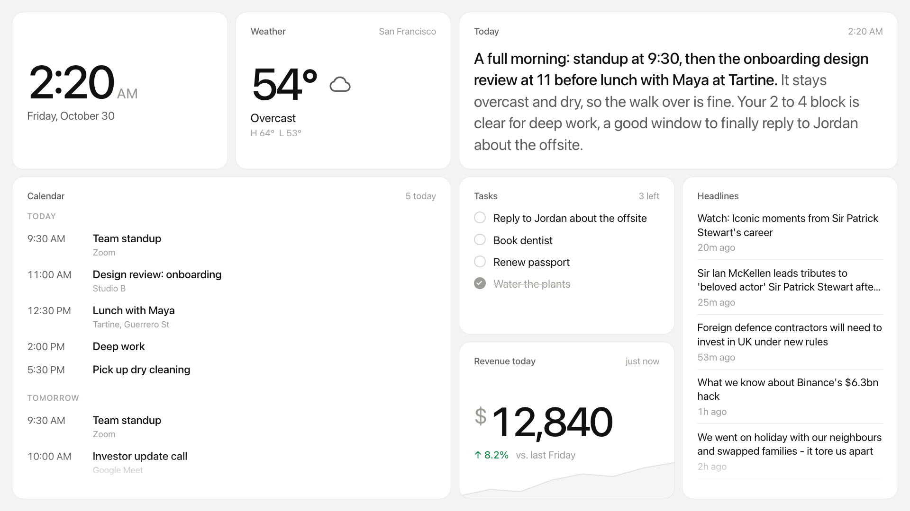
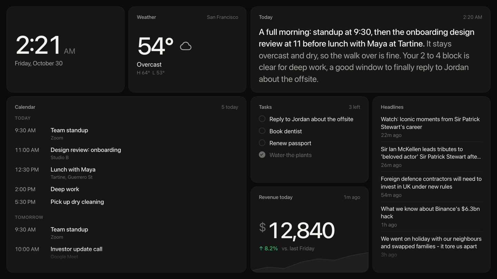
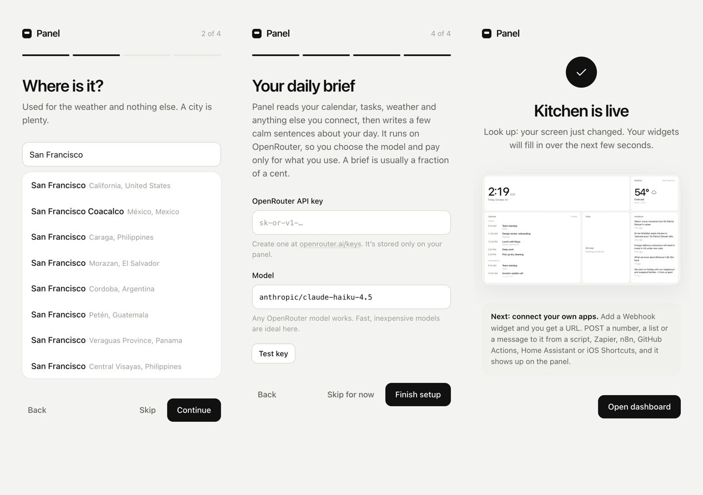
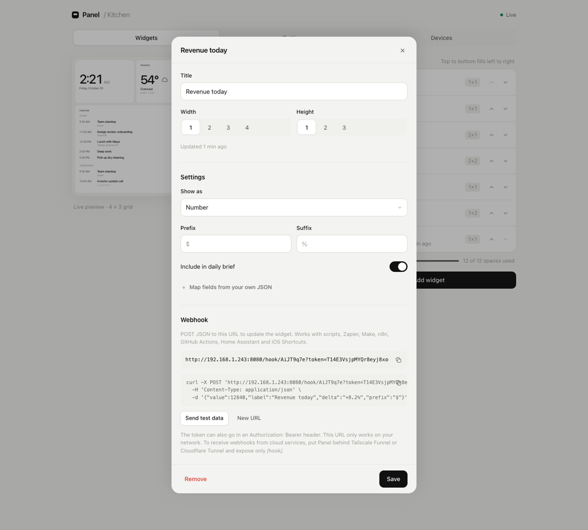
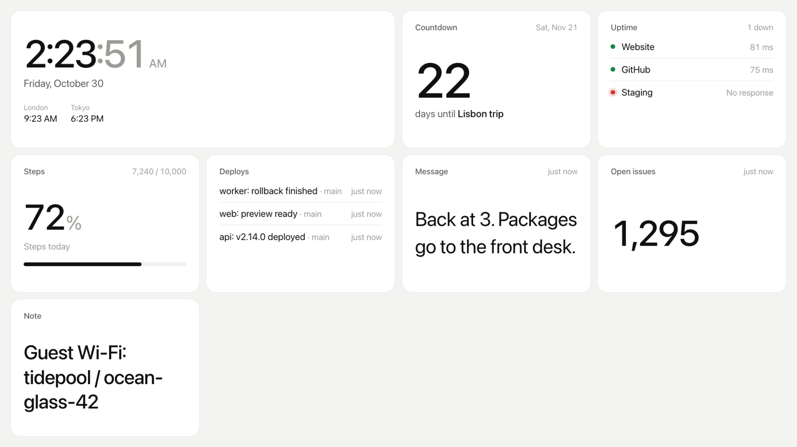
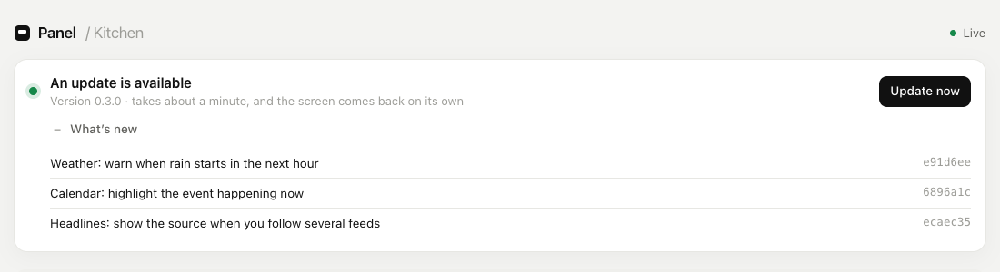
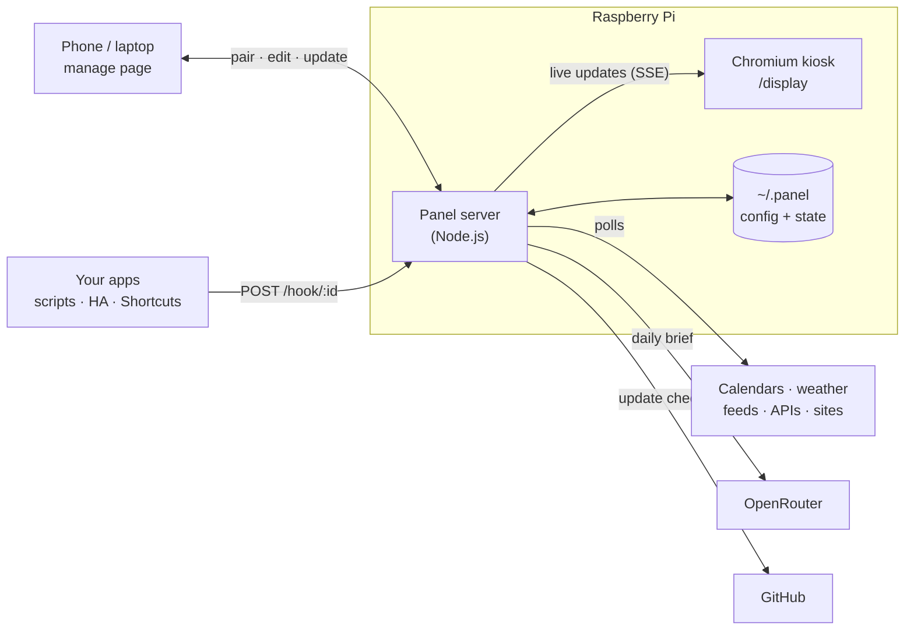

<div align="center">


# Panel

**A calm, glanceable dashboard for a Raspberry Pi and a spare screen.**<br>
Calendar, tasks, weather, your own apps' data, and an AI-written brief of your day.<br>
Set it up and manage it from your phone.

[](LICENSE)
[](https://nodejs.org)
[](#what-you-need)

<br>



</div>

---

## Contents

- [Why Panel](#why-panel)
- [What you need](#what-you-need)
- [Install](#install)
- [First-time setup](#first-time-setup)
- [Managing your panel](#managing-your-panel)
- [Widgets](#widgets)
- [Webhooks: send your own data](#webhooks-send-your-own-data)
- [The daily brief](#the-daily-brief)
- [Updates](#updates)
- [Security and privacy](#security-and-privacy)
- [The `panel` command](#the-panel-command)
- [Troubleshooting](#troubleshooting)
- [FAQ](#faq)
- [How it works](#how-it-works)
- [Development](#development)
- [API reference](#api-reference)
- [Contributing](#contributing)
- [Roadmap](#roadmap)

---

## Why Panel

Most dashboards are built for a desk. Panel is built for a wall, a kitchen counter or the corner of a studio: something you read in two seconds from across the room.

- **One command to install.** Run it on the Pi and reboot. The screen walks you through the rest.
- **No accounts, no cloud.** Scan a QR code on the screen, type the 6-digit code, and your phone is connected. Everything runs on the Pi.
- **Prebuilt widgets** for the things people actually glance at: clock, weather, calendar, tasks, headlines, uptime, countdowns and notes.
- **Your own data with one URL.** Every webhook widget gets its own address. Send it a number, list, event, message or progress value and the screen updates instantly.
- **A daily brief.** Panel reads everything on the screen and asks your choice of AI model (via [OpenRouter](https://openrouter.ai)) for a few calm sentences about your day.
- **Updates from the dashboard.** When a new version is pushed, the manage page shows what changed and installs it in one tap, with automatic rollback if anything goes wrong.
- **One design language.** White cards, big type, generous space. Light, dark, or dark at night.

<p align="center"></p>

## What you need

| | |
|---|---|
| **Computer** | Raspberry Pi 4 or 5 recommended. A Pi 3B+ or Zero 2 W works, a little slower. (Pi Zero / Pi 1 aren't supported by current Node.js.) |
| **OS** | Raspberry Pi OS **Bookworm or newer**, Desktop or Lite. Flash it with [Raspberry Pi Imager](https://www.raspberrypi.com/software/) and set up Wi‑Fi there. |
| **Screen** | Any HDMI monitor or TV. Panel scales to the resolution, from 720p to 4K. |
| **Network** | The Pi and your phone on the same Wi‑Fi. |
| **Optional** | An [OpenRouter API key](https://openrouter.ai/keys) for the daily brief. |

Panel also runs on any Linux machine or Mac with Node 18+ (see [Development](#development)).

## Install

On the Pi, open a terminal (or SSH in) and run:

```bash
curl -fsSL https://raw.githubusercontent.com/Aryanwadhera/panel/main/install.sh | bash
```

It takes a few minutes. The installer:

1. Installs Node.js, Chromium and the Inter font if they're missing.
2. Downloads Panel to `~/panel` and runs it as a system service, so it starts on boot and restarts if it crashes.
3. Offers to rename the Pi to `panel`, so it's reachable at **http://panel.local**.
4. Sets the screen to open Panel full-screen on boot and turns off screen blanking. On the Desktop edition it uses the desktop's autostart; on Lite it runs a minimal kiosk session called [cage](https://github.com/cage-kiosk/cage).
5. Asks to reboot.

Running the same command again is safe: it updates an existing install in place.

<details>
<summary><b>Installer options</b></summary>

<br>

Set these before `bash`, for example: `curl -fsSL … | PANEL_PORT=8080 bash`

| Variable | Default | |
|---|---|---|
| `PANEL_DIR` | `~/panel` | Where the code lives |
| `PANEL_PORT` | `80` | Web port. Falls back to `8080` if 80 is taken |
| `PANEL_KIOSK` | `auto` | `yes` / `no`: open the display full-screen on boot |
| `PANEL_HOSTNAME` | (asks) | Rename the device, e.g. `kitchen` → `http://kitchen.local` |
| `PANEL_REPO` | this repo | Install from a fork |
| `PANEL_BRANCH` | `main` | Branch to install and follow for updates (e.g. a `beta` channel) |

</details>

## First-time setup

After the reboot, the screen shows a QR code and a 6-digit code.

<p align="center"></p>

1. **Scan the QR code** with your phone's camera. Or, on any phone or laptop on the same Wi‑Fi, open **http://panel.local** (or the IP address on screen) and type the code.
2. **Name it** and confirm the time zone, clock style and units.
3. **Choose a city** for the weather. You can skip this.
4. **Pick a few widgets.** Paste a calendar link if you want your agenda ([how to get one](#getting-a-calendar-link)).
5. **Connect the daily brief** with an OpenRouter key and press **Test key**. You can skip this too.

The screen switches to your dashboard the moment you finish.

## Managing your panel

Open **http://panel.local** on any paired phone or laptop.

<p align="center"></p>

| Tab | What's there |
|---|---|
| **Widgets** | A live preview of the screen, your widgets in order (use the arrows to rearrange), and **Add widget**. Tap a widget to change its title, size, settings and webhook. |
| **Settings** | Name, time zone, units and location; grid size (up to 6 × 4); light, dark or dark at night; the daily brief's key and model; software updates. |
| **Devices** | Every phone and laptop you've paired, with a button to disconnect each. |

**The grid.** The screen is a grid, 4 × 3 by default. Each widget takes a number of cells (1×1, 2×1, 2×2 and so on). Widgets fill left to right, top to bottom, and smaller widgets slot into gaps automatically. The capacity bar under the list warns you when things won't fit.

**Adding another device.** Open the same address on it. A fresh code appears on the panel's screen for five minutes. Type it and you're in.

## Widgets

| Widget | Shows | Needs |
|---|---|---|
| **Daily brief** | 2–4 sentences about your day, written from your other widgets | OpenRouter key |
| **Clock** | Time and date, plus extra time zones when there's room | |
| **Weather** | Now, today's high and low, rain chance, and a forecast when there's room | A city (via [Open-Meteo](https://open-meteo.com), no key) |
| **Calendar** | Today and the next few days, with the current event marked. Handles repeating events, exceptions and time zones | A private iCal (`.ics`) link |
| **Tasks** | A to-do list you edit from your phone or by webhook | |
| **Webhook** | A number, list, event feed, message or progress bar | Whatever you send it |
| **Custom API** | The same five styles, filled by polling any JSON URL | A URL (and headers, if needed) |
| **Headlines** | Latest stories from RSS or Atom feeds | Feed URLs |
| **Uptime** | Up/down and response time for your sites, checked every minute | URLs |
| **Countdown** | Days until (or since) a date | |
| **Note** | A line of text: a reminder, a quote, the guest Wi‑Fi | |

<p align="center"></p>

### Getting a calendar link

Panel reads calendars through their private iCal address, so it never needs your password.

- **Google Calendar:** [calendar.google.com](https://calendar.google.com) → ⚙ Settings → pick the calendar under *Settings for my calendars* → *Integrate calendar* → copy **Secret address in iCal format**.
- **Apple iCloud:** Calendar app → right-click the calendar → *Share Calendar…* → tick **Public Calendar** → copy the link.
- **Outlook / Microsoft 365:** Outlook on the web → ⚙ → Calendar → *Shared calendars* → *Publish a calendar* → copy the **ICS** link.

Add several calendars to one widget, one link per line. Calendars refresh every 10 minutes.

## Webhooks: send your own data

Add a **Webhook** widget, choose how it should look, and copy its URL from the editor. Anything that can make an HTTP request can now update your screen.

```bash
curl -X POST 'http://panel.local/hook/AbC123?token=…' \
  -H 'Content-Type: application/json' \
  -d '{"value": 12840, "label": "vs. last Friday", "delta": "+8.2%", "prefix": "$"}'
```

### Payloads

| Style | Send | Behaviour |
|---|---|---|
| **Number** | `{"value": 42, "label": "…", "delta": "+5%", "prefix": "$", "suffix": "ms"}` | Draws a trend line from recent values automatically, or from a `"trend": [..]` you send |
| **List** | `{"items": [{"title": "…", "meta": "…", "status": "ok"}]}` | Replaces the list each time. `status` (`ok`/`down`/`warn`) adds a coloured dot |
| **Event feed** | `{"title": "Deploy finished", "meta": "main"}` | Each post adds a timestamped row at the top |
| **Text** | `{"text": "Back at 3."}`, or a plain-text body | Sized to fill the card |
| **Progress** | `{"value": 7200, "max": 10000, "label": "Steps"}` | Percentage and a bar |

**Tasks** widgets take webhooks too:

```jsonc
{"text": "Water the plants"}                          // add
{"action": "complete", "text": "Water the plants"}    // check off (by text or "id")
// other actions: reopen, toggle, remove, clear (finished), replace (with "tasks": [...])
```

**Sending JSON you don't control?** In the widget editor, open **Map fields from your own JSON** and enter dot paths such as `data.total` or `results[0].name`. Panel pulls the values out of whatever arrives, so you can point a service's webhook straight at Panel.

**Authentication.** Each widget has its own token. Put it in the URL (`?token=`), an `Authorization: Bearer …` header, or `X-Panel-Token`. **New URL** in the editor rotates it.

### Recipes

<details>
<summary><b>A cron job or script</b></summary>

```bash
# crontab -e  →  every 5 minutes, show how many people are on the site
*/5 * * * * curl -fsS -X POST 'http://panel.local/hook/ID?token=TOKEN' \
  -H 'Content-Type: application/json' \
  -d "{\"value\": $(curl -fsS https://example.com/api/active-users)}"
```
</details>

<details>
<summary><b>Home Assistant</b></summary>

```yaml
# configuration.yaml
rest_command:
  panel_power:
    url: "http://192.168.1.50/hook/ID?token=TOKEN"   # use the IP; .local may not resolve inside HA
    method: POST
    content_type: "application/json"
    payload: '{"value": {{ states("sensor.home_power") | int }}, "suffix": " W", "label": "Home power"}'

automation:
  - alias: Panel – home power
    trigger: { platform: time_pattern, minutes: "/1" }
    action: { service: rest_command.panel_power }
```
</details>

<details>
<summary><b>iOS Shortcuts</b></summary>

Add a **Get Contents of URL** action → paste the webhook URL → Method **POST** → Request Body **JSON** → add a field `text` with whatever you like (Shortcut Input works well). Run it from the share sheet, a widget or an automation.
</details>

<details>
<summary><b>GitHub Actions (deploy feed)</b></summary>

Use an **Event feed** widget. This needs Panel reachable from the internet; see the note below.

```yaml
- name: Tell the panel
  if: always()
  run: |
    curl -fsS -X POST "${{ secrets.PANEL_HOOK_URL }}" -H 'Content-Type: application/json' \
      -d '{"title": "${{ github.repository }} ${{ job.status }}", "meta": "${{ github.ref_name }}"}'
```
</details>

<details>
<summary><b>Polling instead of pushing</b></summary>

If a service has an API but no webhooks, use a **Custom API** widget: give it the URL (and an `Authorization` header if needed), choose a style, map the fields, and pick how often to check.
</details>

### Receiving webhooks from the internet

Webhook URLs work on your home network out of the box. Cloud services (Zapier, Stripe, GitHub…) can't reach `panel.local`, so put Panel behind a tunnel and **expose only the `/hook/` path**:

- [Tailscale Funnel](https://tailscale.com/kb/1223/funnel), or
- [Cloudflare Tunnel](https://developers.cloudflare.com/cloudflare-one/connections/connect-networks/) with an ingress rule for `/hook/*`.

Panel never treats tunnelled or proxied requests as local, so even if the whole site is reachable, managing it still requires a code from the physical screen.

## The daily brief

The brief is a card that reads like a note from a thoughtful assistant:

> **A full morning: standup at 9:30, then the onboarding design review at 11 before lunch with Maya at Tartine.** It stays overcast and dry, so the walk over is fine. Your 2 to 4 block is clear for deep work, a good window to finally reply to Jordan about the offsite.

**How it works.** Every widget can describe itself in plain text: the calendar lists what's left today and tomorrow, tasks list what's open, weather says when rain starts, uptime says what's down, webhooks report their numbers. Panel joins those into one digest, sends it to your chosen model with the current time, and shows the reply. The first sentence becomes the headline.

- **Model:** any [OpenRouter model](https://openrouter.ai/models). Fast, inexpensive models are ideal, and a brief usually costs a fraction of a cent.
- **How often:** every 30 minutes to 4 hours, plus **Rewrite now** in the editor.
- **Style:** brief, standard, or a warmer coach voice, plus your own instructions ("I walk to work, so flag rain before 8:30").
- **Transparency:** **See exactly what the AI reads** in the brief's editor shows the full prompt.
- **Keep things out:** turn off *Include in daily brief* on any webhook, API or note widget.

## Updates

<p align="center"></p>

Panel checks for a new version a minute after it starts, then every six hours. When one is found:

- A banner appears at the top of the manage page with the new version and **What's new**, the list of changes since your version.
- **Update now** downloads and installs it. The page shows progress, the panel restarts, and both the screen and the page reload on their own. It usually takes about a minute.
- **Settings → Software update** shows your version, when it last checked, and **Check now**.
- Turn on **Install updates automatically** and Panel installs new versions overnight, between 3 and 6 AM.
- From the Pi's terminal, `panel update` does the same thing.

**Safe by design.** An update is a fast-forward of the git checkout followed by `npm ci`. If either step fails, Panel restores the previous version and keeps running, and the banner says what went wrong. If files in `~/panel` were edited by hand, Panel refuses to overwrite them and tells you how to set them aside.

### Publishing an update (for maintainers and forks)

Panels follow the branch they were installed from (`main` by default). To ship an update:

1. Merge your changes into `main`. **Commit subjects become the "What's new" list**, so write them for the people using the panel: `Weather: warn when rain starts in the next hour`, not `fix wx bug`.
2. Bump `version` in `package.json` for anything worth naming. The banner shows it.
3. Keep `package-lock.json` committed. Updates install exactly what it lists.
4. Push. Panels see it at their next check, or straight away when someone presses **Check now**.

To run a beta channel, push to another branch and install test devices with `PANEL_BRANCH=beta`.

## Security and privacy

- **Local first.** Panel runs entirely on your Pi. Settings, widget data and paired devices are stored in `~/.panel`, readable only by your user.
- **What leaves the device:** requests to the services you configure (your calendar, feeds, APIs, sites to check); [Open-Meteo](https://open-meteo.com) for weather and city search; OpenRouter, only if you set up the brief; GitHub, to check for updates. No analytics or telemetry.
- **Pairing.** Managing the panel requires a code that only appears on its screen, so you have to be able to see it. Codes expire after 5 minutes, and five wrong guesses replace the code with a new one. Paired browsers get a long-lived, HttpOnly cookie, and you can disconnect any of them from **Devices**.
- **Trusted locally.** Requests from the Pi itself (the kiosk and the `panel` command) don't need pairing. Requests forwarded by a proxy or tunnel are never treated as local.
- **Secrets stay put.** API keys, calendar links and custom headers are masked in every API response, including to paired devices.
- **Webhooks** each have their own random token, compared in constant time, and can be rotated at any time.
- **Plain HTTP on your network.** Traffic between your phone and the Pi isn't encrypted, as with most home devices. Don't expose the manage page to the internet, only `/hook/`.

Found a security issue? Please open a private [security advisory](https://github.com/Aryanwadhera/panel/security/advisories/new) rather than a public issue.

## The `panel` command

```text
panel status      Is it running, and where to manage it
panel pair        Show a pairing code in the terminal (handy if the screen is off)
panel logs        Follow the server log
panel reload      Reload what's on the screen
panel restart     Restart the server
panel update      Install the latest version, showing what's new
panel reset       Start over (erases widgets, settings and paired devices)
panel uninstall   Remove the service and autostart
```

**Backups.** Everything that matters is in `~/.panel` (`config.json` and `state.json`). Copy that folder to back up, and put it back on a fresh install to restore.

## Troubleshooting

<details>
<summary><b><code>panel.local</code> doesn't open</b></summary>

Some Android phones, Windows PCs and Docker containers can't resolve `.local` names. Use the IP address shown on the screen or by `panel status`. Make sure your phone is on the same Wi‑Fi, not a guest network.
</details>

<details>
<summary><b>The screen shows the desktop, or nothing</b></summary>

Run `panel status`. If the server is running, check that the Pi boots into the desktop automatically: `sudo raspi-config` → *System Options* → *Boot / Auto Login* → *Desktop Autologin*. Then reboot. On Lite, check the kiosk with `systemctl status panel-kiosk`.
</details>

<details>
<summary><b>The screen goes black after a while</b></summary>

`sudo raspi-config` → *Display Options* → *Screen Blanking* → *No*, then reboot. Also check the monitor's own power-saving settings.
</details>

<details>
<summary><b>The calendar shows an error or no events</b></summary>

Make sure it's the *private/secret iCal* link, not the calendar's web page. Pasting it into a browser should download a `.ics` file. Events appear within 10 minutes; press **Refresh** in the widget editor to fetch right away.
</details>

<details>
<summary><b>The times or weather are off</b></summary>

Panel uses its own time zone setting (Settings → General), not the Pi's. Check that, plus the city and units.
</details>

<details>
<summary><b>The daily brief says it isn't ready</b></summary>

Open the brief's editor. If there's an error, it's usually the key (try **Test** in Settings), credits on your OpenRouter account, or a mistyped model ID.
</details>

<details>
<summary><b>An update failed</b></summary>

Nothing changed: Panel rolled back and is still running the previous version. The banner shows the reason. `panel logs` has the detail, and **Check now** clears the message once a fixed version is published.
</details>

<details>
<summary><b>I lost access from every device</b></summary>

Open the manage page from any device and type the code that appears on the screen. If the screen isn't visible, run `panel pair` on the Pi to print a code.
</details>

## FAQ

**Does it work with a touchscreen?** Panel is designed to be read, not touched, for now. Touch support is on the [roadmap](#roadmap).

**Can I run several panels?** Yes. Each Pi is independent with its own widgets. Give each one a different name with `PANEL_HOSTNAME=office` when installing.

**Can I use it without a Raspberry Pi?** Yes. Any always-on computer with Node 18+ works, and the display is just a web page: open `/display` full-screen in any browser.

**How much does the daily brief cost?** It depends on the model and how often it rewrites. Each brief is a short request (around a thousand tokens), so with a small, fast model an hourly brief comes to roughly a dollar a month or less. Rewriting every few hours costs proportionally less.

**Will it wear out my SD card?** Panel writes only small JSON files, batched every few seconds while data is changing.

## How it works



- **The server** (`server/`) is plain Node.js with a single dependency (for QR codes). It stores settings in JSON, runs a scheduler that keeps each widget fresh, accepts webhooks, and pushes every change to connected screens over server-sent events.
- **The display** (`web/display.html`) is a full-screen page in Chromium. It keeps a live connection, redraws only the cards that changed, sizes everything relative to the screen, and reloads itself when the server restarts after an update.
- **The manage app** (`web/manage.html`) is a phone-first page served by the Pi itself, with no build step and no framework.
- **The installer** sets up a `systemd` service for the server and an autostart entry (or a `cage` kiosk service on Lite) for the browser.

## Development

```bash
git clone https://github.com/Aryanwadhera/panel && cd panel
npm install
npm run dev        # http://localhost:8080 (manage) and http://localhost:8080/display
npm test
```

Requests from `localhost` are trusted, so you won't need to pair while developing. To try pairing, open the manage page from another device on your network using your computer's IP address. Dev data lives in `./.data`.

```text
server/
  index.js          HTTP server and API routes
  auth.js           Pairing codes and device sessions
  scheduler.js      Keeps polling widgets fresh; builds the daily-brief digest
  updater.js        Update checks, install, rollback
  store.js          config.json / state.json persistence
  widgets/*.js      One file per widget type
  lib/              iCal parser, RSS reader, view mapping, OpenRouter client, time zones
web/
  display.html      The screen (kiosk)
  manage.html       Pairing, onboarding and management
  assets/           CSS and JS for both
bin/
  panel             The CLI
  kiosk.sh          Launches Chromium full-screen
install.sh          The one-line installer
test/               node:test suites
```

### Adding a widget type

Create `server/widgets/yourwidget.js` and add it to the list in `server/widgets/index.js`:

```js
export default {
  type: 'stocks',
  name: 'Stocks',
  description: 'Prices for a few tickers.',
  size: { w: 1, h: 2 },          // default size in grid cells
  interval: 300,                 // seconds between fetches (omit for webhook-only widgets)
  fields: [                      // generates the settings form
    { key: 'symbols', label: 'Tickers', type: 'text', placeholder: 'AAPL, MSFT' },
  ],
  view: () => 'list',            // reuse a built-in style: stat, list, feed, text, progress
  async fetch(config, ctx) {     // return data for that style
    return { items: [{ title: 'AAPL', meta: '$231.40' }] };
  },
  summarize(data) {              // optional: what the daily brief reads
    return data.items.map((i) => `${i.title} ${i.meta}`).join(', ');
  },
};
```

- **Field types:** `text`, `url`, `number`, `textarea`, `lines`, `select`, `toggle`, `date`, `location`. Add `secret: true` to mask a value in API responses, `showIf: { key, in: [...] }` to show a field conditionally, and `advanced: true` to tuck it away.
- **Push instead of poll:** implement `ingest(body, previousData, config)` and the widget gets a webhook URL automatically.
- **A custom look:** leave out `view` and add a renderer named after your `type` to the `R` object in `web/assets/display.js`.

## API reference

Everything the manage page does goes through a small JSON API. Requests need a paired session cookie, except from the Pi itself and the routes marked *public*.

| Method | Path | |
|---|---|---|
| `GET` | `/api/status` | *Public.* Name, version, whether you're paired |
| `POST` | `/api/pair/request` | *Public.* Show a pairing code on screen (returns the code to localhost only) |
| `POST` | `/api/pair/confirm` | *Public.* `{code}` → sets the session cookie |
| `POST` | `/hook/:id` | *Public, token required.* Webhook for a widget |
| `GET` | `/api/display/state` | Everything the screen shows |
| `GET` | `/api/stream` | Server-sent events: `state`, `widget`, `update`, `reload` |
| `GET` | `/api/admin/bootstrap` | Settings, widgets, widget catalog, devices, system and update info |
| `PUT` | `/api/settings` | Partial settings update |
| `POST` | `/api/widgets` | `{type, title?, w?, h?, config?}` |
| `PUT` / `DELETE` | `/api/widgets/:id` | Edit or remove |
| `PUT` | `/api/widgets/order` | `{ids: [...]}` |
| `POST` | `/api/widgets/:id/refresh` | Fetch now |
| `POST` | `/api/widgets/:id/action` | Same as the webhook, without a token |
| `POST` | `/api/widgets/:id/token` | Rotate the webhook token |
| `GET` | `/api/widgets/:id/context` | The daily brief's full prompt |
| `GET` | `/api/geocode?q=` | City search |
| `GET` / `POST` | `/api/ai/models` · `/api/ai/test` | OpenRouter model list · key test |
| `GET` | `/api/system/update` | Update status |
| `POST` | `/api/system/check-update` | Check now |
| `POST` | `/api/system/update` | Install (progress arrives as `update` events) |
| `POST` | `/api/system/restart` · `/api/display/reload` | Restart the server · reload the screen |
| `DELETE` | `/api/sessions/:id` | Disconnect a device |

## Contributing

Issues and pull requests are welcome.

- **Bugs:** include your Pi model, OS version (`cat /etc/os-release`), and the output of `panel logs`.
- **New widgets:** see [Adding a widget type](#adding-a-widget-type). Keep them glanceable: one idea per card, readable from across a room.
- **Code style:** plain modern JavaScript with no build step, matching the surrounding code. Run `npm test` before opening a PR.
- **Commit subjects** show up in every panel's "What's new" list, so write them for people, not for the codebase.

## Roadmap

- Touchscreen support: tick off tasks and switch pages on the panel itself
- Screen sleep schedule (turn the display off at night)
- Drag-and-drop layout on the manage page
- More integrations: Todoist, Home Assistant entities, Spotify now playing, photo frame
- Multiple pages that rotate on a timer
- Optional HTTPS on the local network

## License

[MIT](LICENSE)
